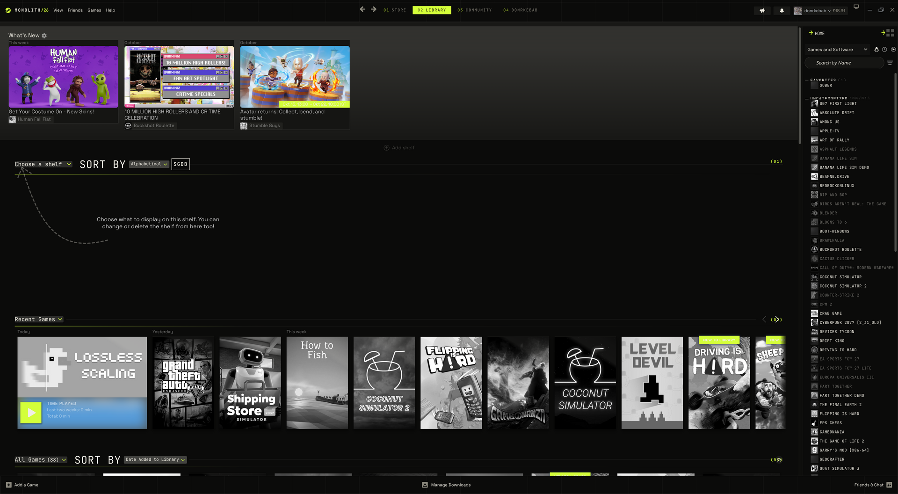
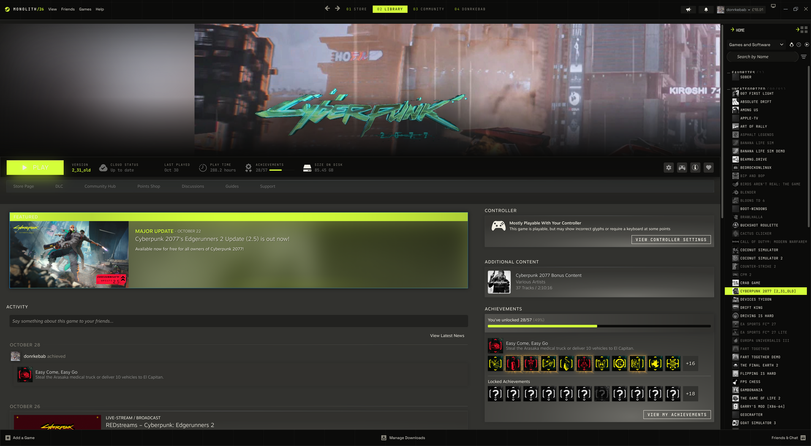
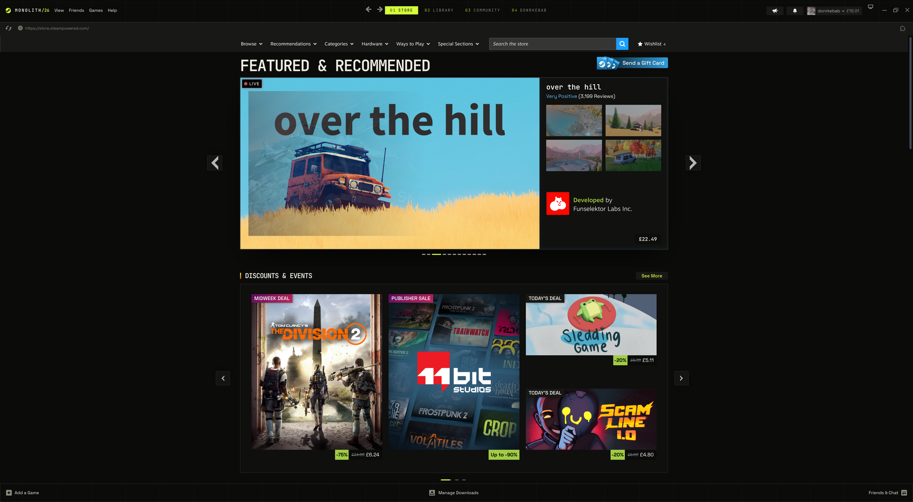

# Monolith

A stark, brutalist terminal look for the Steam desktop client. The sidebar sits on the right, shelves are numbered `(01)`, `(02)`, covers stay black and white until you hover them, and everything is set in monospace with an acid-lime accent.

**Includes:** library, game pages, store and community pages, friends and chat, notifications, menus, sign-in screen, downloads.

## Screenshots




## Install
Requires [Millennium](https://steambrew.app). Open Steam → Millennium → Themes → Install a theme, and paste:
```
https://github.com/ethembeldagli/steam-monolith
```

## Settings
Steam → Millennium → Themes → Monolith → ⚙
- **Accent color:** Acid, Signal, Ice, Ultraviolet
- **Corners:** default, sharp, extra round
- **Motion:** full or reduced
- **Backdrop:** on or off

## License
MIT
